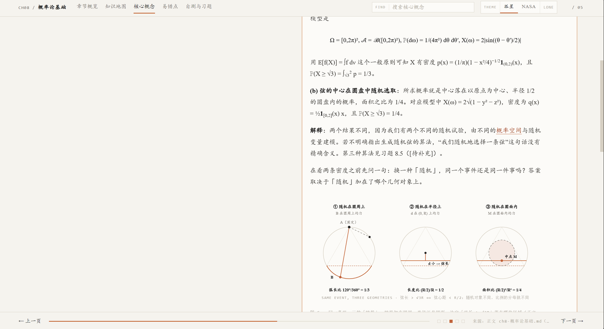
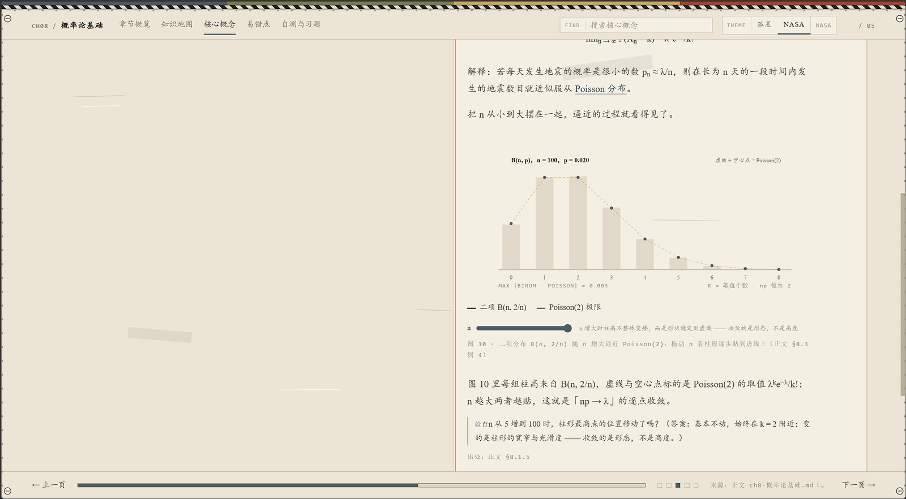

# Dorothy Skills

**版本 0.4.0** · 2026-10-22

两个 agent skill：**dorothy-html** 把课本的一章转成单文件的知识笔记 HTML，**dorothy-picture** 给这类页面画有教学任务的矢量插图。

ps：本项目为肘击大肥鱼生成，是vibe coding的！

**English.** Two agent skills that turn a textbook chapter into something you can actually read. A chapter moves through three layers: the textbook translation (what the book says), a *teaching script* (how to explain it — where the reader gets stuck, why each concept has to exist, which prerequisite is missing), and finally the single self-contained HTML page that merges the two. `dorothy-html` emits that page: an overview, a pan-and-zoom knowledge map, concept cards split into definitions, theorems, and examples, common mistakes, and a quiz, plus two runtime themes and a search over the concept cards. `dorothy-picture` designs the figures that go inside such a page. It runs an eight-stage pipeline, from naming the comprehension barrier to a three-layer acceptance, and emits inline SVG whose colors come from the host page's CSS tokens, so every figure follows the theme for free. No frameworks, no build step, no network at runtime. The deliverable is a file, not a service.

**中文.** 两个 agent skill，把课本的一章变成能读的东西。一章内容走三层：教材译文（书上说了什么）→ 教学稿（**怎么讲**：读者卡在哪、每个概念为什么非存在不可、缺哪个前提）→ 合成出的单文件 HTML。`dorothy-html` 产出的就是最后这一层：概览、可平移缩放的知识地图、按定义 / 定理 / 例子分成三块的概念卡、易错点、自测与习题，双主题可以在运行时切换，概念卡支持全局搜索。`dorothy-picture` 画这类页面里的插图。它走一条从「识别理解障碍」到「三层验收」的八阶段流程，输出内联 SVG，颜色只挂宿主页的 CSS 令牌，所以能自动跟随主题。每张图先在离线复刻上核对数学，再转成 PNG 逐张过目。没有框架，没有构建步骤，运行时也不联网。交付物是文件，不是服务。

## 版本

| 版本 | 主要变化 |
|---|---|
| 0.1 | 卡片版基线：三分板块 + 折叠卡片 + 8 张图。教学层只有半截——学习问题、直觉、前置回放在，但没有「教材原文」分隔，也没有理解检查 |
| 0.2 | 图示规划升级为七问闸门 + 11 字段决策卡，顺手删掉 `figlib.py` 235 行重复定义。**呈现逐字不变**（与 0.1 `diff` 为 0） |
| 0.3 | 教学层（第二层）落进卡片正文：卡头学习问题 → 直觉 → 前置回放 → 教材原文分隔 → 理解检查 + 折叠答案 |
| 0.4 | 教学层回灌**正式模板**并脚本化（`teachlib.py` + `inject_teaching.py`），任何一章一条命令填教学层；前置回放从无条件必需改为**条件必需**；增补段只留一条极浅左线，正文不放「补」字样，文末不做清单 |

0.4.0 的验收线：`check_note.py` 对模板与试点产物都返回 OK，`check_teaching.py` 返回 OK，且 `inject_teaching.py` 连跑两次**逐字节相同**。

## 仓库结构

| 路径 | 内容 |
|---|---|
| `skills/dorothy-html/` | 课本 → 单文件知识笔记 HTML。`SKILL.md`、模板 `assets/note-template.html`（由 `build_template.py` 生成，已内建教学层骨架）、`reference/`（设计规格、内容映射、**教学稿契约** `teaching-contract.md`）、`scripts/`（自检 `check_note.py`、互引 `refs.py`、模板构建 `build_template.py`、教学稿校验 `check_teaching.py`、教学层注入 `inject_teaching.py` 与其内核 `lib/teachlib.py`） |
| `skills/dorothy-picture/` | 教学制图，被 dorothy-html 内联。`SKILL.md`、`reference/`（评估、选图范例、视觉文法、交互图、规划契约）、`assets/`、`scripts/`（图型库 `lib/figlib.py`、渲染核对 `render_fig.js`、机械校验 `check_figure.py` / `check_plan.py`、JS 抽取 `extract_js.py`） |
| `beta/` | 第 8 章「概率论基础」试点：样式源 `_style.css` / `_app.js`、构建 `_build.py` 与 `_build_tk.py`、教学稿 `ch08-概率论基础_teaching.md`、插图片段 `figs/`、制图规划与成本清单、四个版本快照 `ch08-beta0.1–0.4.html`。成品 HTML、教学稿与教材原文片段**不入库**（含第三方教材的逐句翻译正文，见 `.gitignore`），需要的话用你自己的材料在本地生成 |
| `参考教材 报告/` | 参考教材的图文设计分析，用来提炼选图与排版规则。**仅本地留存、不入库**（含第三方教材截图，见 `.gitignore`） |

## 安装

两个 skill 都是纯文件（`SKILL.md`、参考文档、脚本），复制到 agent 的技能目录就能用，没有编译或打包步骤。

### 1. 取到本地

```bash
git clone git@github.com:Dorothy-Haitianxia/dorothy-learn-skills.git
cd dorothy-learn-skills
```

### 2. 复制到技能目录

```bash
# macOS / Linux
mkdir -p ~/.agents/skills
cp -r skills/dorothy-html skills/dorothy-picture ~/.agents/skills/
```

```powershell
# Windows PowerShell
New-Item -ItemType Directory -Force "$HOME\.agents\skills" | Out-Null
Copy-Item -Recurse -Force .\skills\dorothy-html, .\skills\dorothy-picture "$HOME\.agents\skills\"
```

目录名必须与 `SKILL.md` 里 frontmatter 的 `name` 一致（`dorothy-html` / `dorothy-picture`）。

### 3. 装渲染依赖（只有 dorothy-picture 需要）

`dorothy-picture` 里「渲染成 PNG 亲眼核对」这一步靠 `@resvg/resvg-js`。这是个纯本地的预编译包，不用装系统级图形库：

```bash
cd ~/.agents/skills/dorothy-picture
pnpm install --ignore-scripts
```

不做渲染核对也能用，`check_figure.py` 等校验脚本不依赖它。

### 4. 验证

```bash
# 模板回归（应输出 OK）
python skills/dorothy-html/scripts/check_note.py skills/dorothy-html/assets/note-template.html

# 脚本语法
python -c "import py_compile; py_compile.compile('skills/dorothy-picture/scripts/lib/figlib.py', doraise=True)"
node --check skills/dorothy-picture/scripts/render_fig.js
```

### 依赖一览

| 依赖 | 用在哪 | 是否必需 |
|---|---|---|
| Python 3.9+（只用标准库） | 全部校验与生成脚本 | 是 |
| Node.js + pnpm | `render_fig.js` 渲染 PNG 核对 | 仅在渲染核对时需要 |
| `@resvg/resvg-js` | 同上 | 随 `pnpm install` 安装 |

装好后**重启 agent 会话**，skill 才会出现在技能目录里。

---

# 知识笔记 HTML 生成 Skill（dorothy-html）

把一章课本正文（含章末习题）做成一份**单文件、直接用浏览器就能打开**的知识笔记页。版式是宽屏翻页式，从章节概览到知识地图、核心概念、易错点，最后是自测与习题。页内有可平移缩放的知识地图、点开前置概念的互引浮层，以及按 lieflat 结构排的辅助插图。



切到 NASA-punk 主题后，同一页的配色和线条整体换掉，图也跟着变色。下图中间的柱状图可以拖动 n。



> 截图中的正文与例题来自第三方教材，仅用于展示页面效果，仓库不含其全文。

## 交付物

| 路径 | 说明 |
|---|---|
| `skills/dorothy-html/SKILL.md` | skill 本体：输入输出、五页结构、卡片字段、互引规则、插图规则、视觉与交互硬约束、生成流程、自检清单 |
| `skills/dorothy-html/assets/note-template.html` | 可运行模板（宽屏翻页版）：令牌化 CSS + 五页骨架 + **内建教学层骨架** + 地图/浮层/插图示例 + 交互层。**不要手改这份文件**，它由 `build_template.py` 生成 |
| `skills/dorothy-html/reference/design-spec.md` | 颜色令牌、**双主题（令牌键名契约、装饰件层、主题切换的唯一具名例外）**、橙色范围、深色块、字体与**数学兜底 `@font-face`**、排版尺度、动效词表、断点、可访问性 |
| `skills/dorothy-html/reference/content-mapping.md` | 输入 → 五页/卡片映射、**互引取词与守卫规则**、插图数据来源、统计口径、缺料写法 |
| `skills/dorothy-html/reference/teaching-contract.md` | **教学稿契约**：三层分工、读者档位、前置概念的 N 规则、单元粒度与字段、与 dorothy-picture 的分工、修改纪律、校验器约定、教学层在 HTML 里的落位 |
| `skills/dorothy-html/scripts/check_note.py` | 产物自检：令牌化、无圆角阴影 emoji 外链、五页与翻页器、互引链接、浮层结构、插图配对、动画属性、出处行、**教学层计数** |
| `skills/dorothy-html/scripts/refs.py` | 互引引擎：别名表 + 左右守卫 + 偏移映射 + 行内标签边界扩展；`--file` 出审报告，`--apply` 写标记 |
| `skills/dorothy-html/scripts/check_teaching.py` | **教学稿自检**：档位、六必需字段、增补计数（正文 ↔ 文末附表对账）、N 值表、卡片覆盖、禁用词 |
| `skills/dorothy-html/scripts/inject_teaching.py` | **教学层注入**：把教学稿按固定骨架填进卡片 HTML，幂等（先剥离旧层再重建）；`--dry-run` 只报数 |
| `skills/dorothy-html/scripts/lib/teachlib.py` | 教学稿解析与渲染的唯一实现：单元 / 簇、字段、前置回放的术语抽取、MD 轻渲染、`[增补]` 段落标记 |
| `skills/dorothy-html/scripts/build_template.py` | 模板构建脚本：把 beta 的样式与交互层搬进模板骨架 |
| `beta/ch08-概率论基础-卡片版.html` | 第 8 章试点成品（**不入库**，本地生成）。含 §8.3 课本章末习题 8.1–8.16；课本没给解答，标 `[待补充]` |
| `beta/ch08-概率论基础_teaching.md` | 该章的教学稿（第二层）。**含教材转述，不入库**；格式见 `teaching-contract.md` |
| `beta/_style.css` · `beta/_app.js` | 模板的唯一样式/交互源：`build_template.py` 把这两个文件原样写进模板（改样式改这里，不要直接改模板） |
| `beta/_exercises.html` | 课本章末 16 道习题的卡片片段（题目照抄正文，由 `_build.py` 拼进末页）；**含教材内容，不入库** |
| `beta/ch08-概率论基础_refs-review.md` | 该成品的 23 处互引清单（别名表、守卫表、每处上下文） |

## 教学层：第二层教学稿

0.3 起，写进页面的内容分三层，各归其位：

| 层 | 文件 | 回答什么问题 |
|---|---|---|
| 第一层 教材译文 | `beta/_source.html` | 书上说了什么（逐句翻译，不改动） |
| 第二层 教学稿 | `ch08-概率论基础_teaching.md` | **怎么讲**：读者的卡点在哪、这个概念为什么非存在不可、缺哪个前提 |
| 第三层 HTML | `ch08-概率论基础-卡片版.html` | 怎么排、怎么点（前两层机械合成，不许在排版时改内容） |

教学稿是纯 Markdown，一章一份，按簇 → 单元组织。每个单元挂一张或几张卡，字段固定：

```markdown
### B1 分布函数 F_X（`c5`）

**学习问题**：已经有 ℙ_X 了，为什么还要一个 F_X？

**直觉**：[增补] ℙ_X 是个集函数——要问"概率多少"得先给一个集合；F_X 把它压成一个实变量的普通函数，代价是只保留"≤ t"这一族集合的信息。

**正式**：F_X(t) := ℙ(X ≤ t) = ℙ_X((−∞, t])（§8.1.6）。由推论 1.19，F_X 刻画 ℙ_X……

**前置回放**：无（本节只用上面已回放过的概念）。

**检查**：若 F_X 在 t = 2 处有一个高度 0.5 的跳跃，ℙ(X = 2) 是多少？**答案**：0.5；而 ℙ(X < 2) = F_X(2−) = F_X(2) − 0.5。

**图示任务**：**出图**（图 6，`compare()`；图 11，`cdf_jumps()`）。评分 1/0/1/2 = 4……
```

六项必需字段（学习问题 / 正式 / 检查 / 图示任务 / 前置回放 / 来源）缺一项就不算单元；直觉、图前引导、图后解释、为什么画成这样 是条件字段。完整规则见 [teaching-contract.md](skills/dorothy-html/reference/teaching-contract.md)。

**落到页面上的位置**（模板已内建骨架，照教学稿填空即可；教学稿缺哪块就整块删掉，不留空壳）：

| 教学稿字段 | 页面位置 | 收起时可见 |
|---|---|---|
| 学习问题 | `.card__summary` 之后的 `.tk-q`（一条橙线） | **可见** |
| 直觉 | panel 内 `.tk-note`（浅灰底 + 小标） | 展开 |
| 前置回放 | panel 内 `details.is-recall`，折叠态一行 `+ 回放 · N 处：概念名` | 展开 |
| 正式 | panel 内 `.tk-src`，带「教材原文」小标与一条分隔线 | 展开 |
| 检查 | panel 内 `.fig__check.tk-check` + 内嵌 `details.tk-ans`「看答案」 | 展开 |
| `[增补]` 段落 | 段级 `.is-added`：一条极浅左线 | 展开 |

**两条纪律**（踩过才知道）：

- **前置回放只写本章没有卡的前提**。跨课程工具和前几章结论才回放；本章已有卡、浮层与知识地图都能跳到的，写「无新增」。试点第一轮写了 21 条，被这条门槛删掉 2 条（随机变量是函数、Poisson 分布）——复述本章已有的卡只是噪音，而且会把真正跨课程的前提挤掉。
- **哪句是书、哪句是导师，必须当场可辨**。凡 `[增补]` 开头的段落（类比、直觉模型、教材没写的中间步骤）进页面后带 `.is-added` 左线；正文里不放「补」字样，文末也不做清单（读起来像附录报表，会打断翻页）。教学稿自己的文末仍留逐条清单，那是审计用的。

**命令**：

```powershell
# 校验教学稿（档位 / 六必需字段 / 增补对账 / N 值表 / 卡片覆盖）
python -X utf8 scripts\check_teaching.py '<产物>_teaching.md' --html '<产出.html>' --plan '<产物>_figures-plan.md'

# 把教学稿机械地填进已生成的卡片 HTML（幂等：先剥离旧教学层再重建）
python -X utf8 scripts\inject_teaching.py '<产出.html>' --teaching '<产物>_teaching.md'
python -X utf8 scripts\inject_teaching.py '<产出.html>' --teaching '<产物>_teaching.md' --dry-run   # 只报数
```

注入与手写二选一：先跑脚本，再人工改文句；重复跑结果逐字节相同，也能把模板自带的占位内容换成真内容。一个单元管多张卡时（标题里写 `c4 t5+t6`），教学层只落第一张——学习问题讲的是「这个单元」，不是「这一张卡」。

## 页面内部结构（运行时）

| 控件 | 位置 | 行为 |
|---|---|---|
| 主题开关 | 顶栏右上角 `.chrome__tools` | 孤星 ⇄ NASA-punk；颜色 0.34s 交叉过渡（唯一的具名例外）+ 百分比进度条，`localStorage['dorothy:theme']` 记忆 |
| 核心概念分段控件 | `#p-core` 子标题 `.section__head` | 定义 / 定理 / 例子**三板块分屏**（默认定义，其余 `hidden`）；三段等宽、指示条只动 `transform:translateX(calc(var(--tab) * 100%))`；**每块各自记 scrollTop**；地图节点、`#c3` 卡片深链都会先切到卡片所在板块再展开+滚动。标题行 `position:sticky` 钉在顶部（`top:-26px` 上探 26px 盖住滚过去的卡片，`margin-top:-30px` 抵消初始位移），**滚到下面的卡也能直接切板块** |
| 末页分段控件 | `#p-quiz` 子标题 | **两块**（自测 / 课本章末习题，`.tabs--two` 两格；默认自测）；与核心概念共用同一套 `showBoard()`，`data-board` 全局唯一（`self` / `exercise`） |
| 概念速览浮层 | `#refBox` | 橙色下划线术语点开前置概念；逐层返回栈；关闭回到原处并闪一下 |
| 全局搜索 | 顶栏右上角 | 只索引 `#p-core` 的卡片（剔除出处行）；多词 AND，权重 标题 3 > 摘要 2 > 正文 1；结果给语义标签 + 标题 + 带 `<mark>` 的匹配片段，点击跳转并自动切板块；中文输入法与 `←/→` 都做了处理 |
| 教学层 | `#p-core` / `#p-pit` 的每张卡 | 卡头 `.tk-q` 学习问题（收起可见）；展开后 直觉 → 前置回放（折叠）→ 教材原文 → 理解检查 + 折叠答案 → 出处；`[增补]` 段落带 `.is-added` 左线 |

三段卡数写进 `.tabs__n`；`openCard(id)` 是地图 / 搜索 / 深链的共同入口，改跳转逻辑只改它。

卡片展开 / 收起走 `grid-template-rows: 0fr → 1fr` 过渡（0.22s），不写死 `height`：内容多长都能平滑撑开，同组互斥时旧卡是「缩」下去而不是瞬间消失，也不会触发 `check_note.py` 的动画属性断言（它拦 `transition` 里出现 height / width / max-height）。

## 全局安装（与本工作区源码同步）

这是一个**全局 skill**，装在 `$HOME\.agents\skills\dorothy-html\`（与 `lieflat-charts`、`archify` 同级），已在 `$HOME\.agents\skills-registry.md` 登记。

```powershell
# 工作区源码 → 全局安装
Copy-Item -LiteralPath '<repo>\skills\dorothy-html' `
          -Destination "$HOME\.agents\skills\dorothy-html" -Recurse -Force

# frontmatter 校验（name 必须与目录名一致）
& 'python' -c "import re,yaml,pathlib; t=pathlib.Path(r'<skills>\dorothy-html\SKILL.md').read_text(encoding='utf-8'); m=yaml.safe_load(re.match(r'^---\r?\n(.*?)\r?\n---\r?\n',t,re.S).group(1)); print(m['name'], len(m['description']), '字符')"
```

**注意**：`description` 里出现 ` #`（空格加井号）时，YAML 会当成注释，把后面的描述截断。写 frontmatter 时给它加上双引号。这个坑我们踩过一次，描述只剩 29 个字符。

## 用法

1. 提供该章课本正文的 Markdown。章末习题通常就在正文末尾，一起给过来就行。这个 skill 只处理课本材料，不收笔记类输入。
2. 产出 `chXX-章节名.html`。
3. 自检与互引审核：

```powershell
$env:PYTHONUTF8='1'; $env:PYTHONIOENCODING='utf-8'
$py = 'python'
$sk = "$HOME\.agents\skills\dorothy-html"      # 或工作区源码 skills\dorothy-html
& $py -X utf8 "$sk\scripts\check_note.py" '<产出.html>'
& $py -X utf8 "$sk\scripts\refs.py" --file '<产出.html>'          # 先审
& $py -X utf8 "$sk\scripts\refs.py" --file '<产出.html>' --apply --out '<产出-marked.html>'
& $py -X utf8 "$sk\scripts\check_note.py" '<产出.html>' --plan '<产物>_figures-plan.md'   # 与制图清单对账
```

4. 有教学稿就一条命令把教学层填进去（没有就手写或整块跳过）：

```powershell
& $py -X utf8 "$sk\scripts\check_teaching.py" '<产物>_teaching.md' --html '<产出.html>'
& $py -X utf8 "$sk\scripts\inject_teaching.py" '<产出.html>' --teaching '<产物>_teaching.md'
& $py -X utf8 "$sk\scripts\check_note.py" '<产出.html>'            # 重跑，看教学层计数
```

## 构建与三个对照版本

`beta/` 下的成品都**不入库**（含教材正文），但构建脚本入库，可以对着你自己的材料跑。

| 命令 | 产物 | 形态 |
|---|---|---|
| `python beta/_build.py` | `beta/ch08-概率论基础.html` | 静态图版：三分板块 + 折叠卡，无教学层 |
| `python beta/_build.py interactive` | `beta/ch08-概率论基础-交互版.html` | 图 5 换成可拖动的三格动态图（交互版里编号为图 8）、图 2 换成可拖动 n 的二项逼近 Poisson，另加密度带拖拽与分布函数跳跃两张动态图 |
| `python beta/_build_tk.py` | `beta/ch08-概率论基础-卡片版.html` + `-叙事版.html` | **带教学层**的两个对照版本：卡片版沿用三分板块与折叠卡；叙事版按教学稿的簇顺序重排、卡片全部展开、单列连续长文 |

`_build_tk.py` 不重复实现装配：它把 `_build.py` 当模块跑一遍，拿同一批卡片、同一张地图、同一份图与同一份互引，差异只在容器与排序——这样两版的对比才有效。教学层文本的唯一来源是教学稿。

`_build.py` 读的是本地的 `beta/_source.html` 与 `beta/_exercises.html`（含教材正文，不入库）。clone 下来直接跑会缺输入——这两个文件要用你自己的材料生成。

反直觉的地方：交互版反而更小（约 306 KB 对 334 KB）。静态柱状图要写几千条 `<line>` 才画得出「一根横档 = 1% 概率」，动态图只存一份绘制代码，按参数重算。

## 成品自检结果（ch08 · 0.4.0）

```
check_note.py     → OK   知识卡 33 张 / 自测题 10 道 / 课本章末习题 16 道 / 出处行 59 / 板块 5 个（2 组分段控件）/ 语义标签 DEF×11 ERR×7 EX×5 THM×10 / [待补充] 18 处
                  教学层：学习问题 30 / 前置回放 19 / 教材原文分隔 30 / 理解检查 30（答案折叠 30）/ 增补段 51（左线区分）
check_teaching.py → OK   档位 A+ · 分簇 6 · 单元 30 · 增补 51 处 / 附表 51 行 · 标出图的卡 8 张
refs.py           → 会标出 23 处；同卡重复不标 23 处；被守卫拦下 0 处
frontmatter       → name=dorothy-html，description 完整（PyYAML 一行校验，见下）
```

## 双主题：孤星 ⇄ NASA-punk（运行时切换）

NASA-punk 已经**收进基础样式**，作为第二套令牌存在，不再是单独的构建变体。同一份 HTML 里装两套主题，在顶栏右上角切换，不用另出文件。

| 位置 | 内容 |
|---|---|
| `beta/_style.css` 的 `:root[data-theme="nasapunk"]{}` | NASA-punk 的令牌块（设备白 `#ECE5D6`、身份四色 `#4C5A68 #7A7F4E #D2A85E #A8432F`、唯一鲜色 `#D63A2C`）+ 机身线条：彩条、警示斜纹、接缝铆钉、角螺丝、卡片双细线、痕迹覆盖层 |
| `beta/_style.css` 的 `.np-chrome` | 装饰件常驻 DOM：孤星下 `display:none`（不占排布），NASA-punk 下 `display:contents` 并按 34ms 级联淡入 |
| `beta/_app.js` 的主题模块 | `setTheme()`：加 `.is-theming` → 强制重排 → 换 `data-theme` → rAF 驱动百分比进度条 → 驻留 240ms 后淡出；`localStorage['dorothy:theme']` 记忆，`try/catch` 兜底 |

**只改线条和配色。** 主题块里没有任何字体相关的覆盖（`font-family`、`font-size`、`letter-spacing`、`text-transform`、`font-style`、`line-height` 都没有），字体沿用基础样式的 Times New Roman + 霞鹜文楷 + NoteMath + Consolas。回归验证过：切换前的 NASA-punk 单主题产物和现在的双主题产物，核心概念与易错点两段**逐字相同**（113506 字符），3 张插图与知识地图 SVG 也逐字相同。

**令牌键名两套齐全。** 主题块只允许覆盖，不允许新增键。NASA-punk 专用的令牌（`--red`、`--s1..--s4`、`--rivet`、`--wear-*`）在基础 `:root` 里也留了占位值，否则切回孤星会缺声明。`check_note.py` 会断言这一点。

# 教学制图 Skill（dorothy-picture）

给数学与课本材料画**有教学任务**的矢量图。它不做装饰：一张图要么替读者完成一次推理，要么就不该存在。

上面的截图里那两张图（三格几何图、二项分布逼近 Poisson 的柱状图）就是它生成的。

## 流程：从理解障碍出发

常规做法是先想画什么、再想怎么画。这里反过来，先把障碍说清楚：

1. **提取知识点**：把一章拆成可独立讲授的知识单元
2. **识别理解障碍**：逐个问读者会在哪里卡住，卡的是什么
3. **四维打分**：结构 / 过程 / 直观 / 辨析各 0–2 分；**任一维 = 2 或总分 ≥ 4** 才进入制图，否则明确写「不出图」及理由
4. **七问闸门**：最关键的三问是「删掉这张图读者会失去什么」（拦装饰）、「不能暗示哪些错误结论」（拦误导）、「不画的话最好的替代文本是什么」（拦「想不清楚就画一张糊过去」）
5. **决策卡与编排**：11 个字段定死教学任务、视觉顺序、图文对应与替代文本；编排只留三种默认（并置 / 分阶段揭示 / 并列对照），另外五种必须写理由
6. **规格检查**：`check_plan.py` 机械校验打分、11 字段、编排合法性、替代文本、状态机、锚点
7. **实现**：写内联 SVG（图型库 `figlib.py` 提供几何图元与布局）
8. **三层验收**：数学正确性、视觉表达、教学有效性**分开记**，不合并。三者层级不同，一合并就会让人用「好看」盖住错误

## 图型库

六类「障碍图型」，每类对应一种理解障碍：

| 障碍 | 图型 | 生成函数 |
|---|---|---|
| 不知道对象之间谁连谁 | 结构关系图 / 依赖图 | `objmap()` `depgraph()` |
| 看不出过程分几步 | 分阶段图 | `stages()` |
| 跟不上推理的每一步依据 | 证明流程图 | `proof()` |
| 两个概念分不清 | 对照反例图 | `compare()` |
| 概率与区间对不上 | 区间/事件图 | `axis()` |
| 解析式画不出图形 | 几何直觉图 | `gcircle()` `garc()` `gchord()` `gpoly()` |

另有复合图型：`chord_models()`（同一事件的不同随机模型并置）、`cdf_jumps()`（分布函数的跳跃与原子）、`marginal_joint_pair()`（边缘相同、联合不同）、`pushforward_pair()`（原像与推前测度），以及可拖动的交互图变体。

## 硬约束

- 图内**只挂语义类**，颜色一律走宿主页的 CSS 令牌，因此能跟着页面在孤星和 NASA-punk 之间切换，不需要额外成本
- 禁止装饰性配图，禁止以图代证
- 生成后**必须渲染成 PNG 亲眼核对**：几何错位、元素重叠、标签压线这类问题，代码审查抓不到
- 交互图另加一层运行时验收（自动化测不了，只能人工拖一遍）

## 产物

| 文件 | 内容 |
|---|---|
| `<产物>_figures-plan.md` | 制图规划清单：逐知识点打分、出图/不出图理由、11 字段决策卡与编排、三层验收记录 |
| `<产物>_figures-cost.md` | 成本账：可复核的原始量（写入字符数、渲染轮次、返工次数）与换算口径 |
| `figs/fig-*.html` | 自包含的 `<figure>` 片段，由 dorothy-html 内联进成品页 |

## 工具

| 脚本 | 作用 |
|---|---|
| `scripts/lib/figlib.py` | 图型库：几何图元、布局、六类障碍图型、数据图 |
| `scripts/check_figure.py` | 片段校验：可访问性、图注格式、颜色字面量、字号、类名白名单、图元密度 |
| `scripts/check_plan.py` | 清单校验：打分完整性、11 字段、编排合法性、替代文本、状态机、锚点与卡片对账 |
| `scripts/render_fig.js` | 渲染 PNG：从宿主页抽 CSS 令牌、解析 `var()`、注入 `<style>` 后交给 `@resvg/resvg-js` |
| `scripts/extract_js.py` | 抽出图内联脚本，交给 `node --check` 验语法 |

## 用法

```bash
# 列出页面里的所有图
node skills/dorothy-picture/scripts/render_fig.js --html beta/ch08.html --list

# 渲染某张图核对（可选 --theme nasapunk 看深色主题）
node skills/dorothy-picture/scripts/render_fig.js --html beta/ch08.html --id fig-5-chord --out out.png

# 导出脱离宿主页的自包含 SVG（token 已烘焙成具体色值）
node skills/dorothy-picture/scripts/render_fig.js --figure beta/figs/fig-5-chord.html --css beta/_style.css --out fig.svg --bake

# 校验
python skills/dorothy-picture/scripts/check_figure.py beta/figs/*.html
python skills/dorothy-picture/scripts/check_plan.py beta/ch08_figures-plan.md --html beta/ch08.html
```

## 与 dorothy-html 的关系

dorothy-picture 不单独交付页面。它产出的 `figs/*.html` 由 dorothy-html 内联，图号、图注、alt 和正文里的引用都由宿主页统一管理。两者共用同一套语义类名，登记在 [design-spec.md](skills/dorothy-html/reference/design-spec.md) 第十二节。

分工的接缝在**教学稿的「图示任务」字段**：写卡人只判断「这里该不该画、画了替读者完成哪一步推理」，具体怎么画由 dorothy-picture 的 11 字段决策卡决定；图前引导与图后解释的正文仍回教学稿里写（它们属于讲述，不属于图）。

---

## 协作与致谢

**人类作者**：选题、找材料、定验收标准，逐条判断哪些产出留下、哪些扔掉。

**AI 协作**：DeepSeek 参与两个 skill 的代码、参考文档与这份 README 的起草。所有产出（包括每一张图、每一条校验规则）都经人工看过才保留——这一版的制图流程之所以把「渲染成 PNG 亲眼核对」和「三层验收分开记」定成硬约束，就是被机器生成物坑过之后补上的。

> 关于 GitHub 的 Contributors 面板：它只统计能映射到 GitHub 账号的提交作者，AI 没有账号，所以不会以头像的形式出现在那里。协作关系记在这一节。

---

MIT License · 见 [LICENSE](LICENSE)
